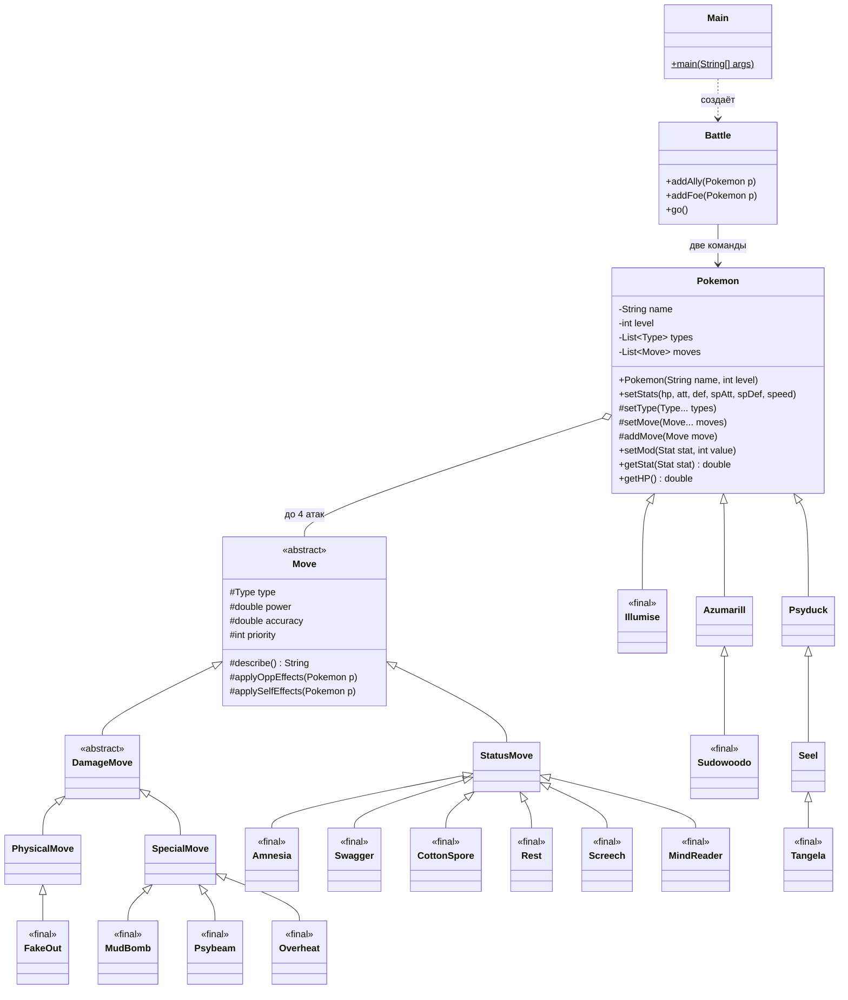

# Лабораторная работа №2 — Покемоны

Программа описывает 6 покемонов и 10 атак из варианта 4444, делит покемонов на две команды по три и запускает между ними бой. Сам бой полностью ведёт готовый класс `Battle` из библиотеки `Pokemon.jar`. Наша задача — правильно описать покемонов и атаки через наследование.

## 1. Задание (кратко)

1. На основе класса `Pokemon` написать классы для покемонов варианта. У каждого 1–2 типа и 6 базовых характеристик: HP, атака, защита, спец. атака, спец. защита, скорость.
2. Классы покемонов наследуются по цепочке эволюции.
3. На основе `PhysicalMove`, `SpecialMove` и `StatusMove` написать классы атак: тип, сила (power), точность (accuracy) и стандартный эффект.
4. Классы без наследников сделать `final`, чтобы от них нельзя было наследоваться.
5. Уровень покемона выбрать минимально необходимым для всех его атак.
6. Создать 2 команды (у каждого покемона есть имя) и запустить бой.

Покемоны варианта:

| Покемон | Атаки |
| --- | --- |
| Illumise | Mud Bomb, Psybeam, Amnesia, Overheat |
| Azumarill | Fake Out, Swagger, Overheat |
| Sudowoodo | Fake Out, Swagger, Overheat, Cotton Spore |
| Psyduck | Rest, Swagger |
| Seel | Rest, Swagger, Screech |
| Tangela | Rest, Swagger, Screech, Mind Reader |

## 2. Структура проекта и запуск

```
lab2/
  src/
    Main.java          — создаёт Battle, добавляет покемонов в команды, запускает бой
    pokemons/          — 6 классов покемонов
    moves/             — 10 классов атак
  test/                — JUnit-тесты (в jar не попадают)
  lib/Pokemon.jar      — библиотека с базовыми классами (пакет ru.ifmo.se.pokemon)
  MANIFEST.MF          — Main-Class: Main и Class-Path: lib/Pokemon.jar
  build.sh, run.sh, test.sh
```

`Pokemon.jar` не распаковывается, а подключается как внешняя библиотека. При компиляции его передают через `-cp`. При запуске его находит строка `Class-Path` в манифесте `lab2.jar`:

```
javac -cp lib/Pokemon.jar -d out src/Main.java src/pokemons/*.java src/moves/*.java
jar cfm lab2.jar MANIFEST.MF -C out .
java -jar lab2.jar
```

Без манифеста тот же запуск выглядел бы так: `java -cp lab2.jar:lib/Pokemon.jar Main`.

- Локально: `./build.sh`, затем `./run.sh` (всё внутри Docker), тесты — `./test.sh`.
- На helios всё уже лежит в `~/lab2/`: `lab2.jar` и `lib/Pokemon.jar`. Запуск: `cd lab2 && java -jar lab2.jar`. Если Java ругается на память («Could not reserve enough space»), нужно ограничить её: `java -Xmx256m -jar lab2.jar`.
- Бой идёт 1–2 минуты, потому что библиотека делает паузу 1 секунду перед каждой атакой.

## 3. Диаграмма классов

Классы `Pokemon`, `Move`, `DamageMove`, `PhysicalMove`, `SpecialMove`, `StatusMove` и `Battle` — из библиотеки `ru.ifmo.se.pokemon`, остальные написаны нами. `<<final>>` — класс, от которого нельзя наследоваться.



Диаграмма написана на Mermaid. Её показывают GitHub, IntelliJ IDEA и VS Code. Для отчёта есть готовая картинка: [class-diagram.png](class-diagram.png).

## 4. Как это работает

### Покемон = конструктор, который всё настраивает

Каждый класс покемона — это только конструктор. Он вызывает конструктор родителя и задаёт тип, характеристики и атаки:

```java
public class Azumarill extends Pokemon {
    public Azumarill(String name, int level) {
        super(name, level);                          // конструктор Pokemon: имя и уровень
        setType(Type.WATER, Type.FAIRY);             // 1–2 типа
        setStats(100, 50, 80, 60, 80, 50);           // HP, атака, защита, сп.атака, сп.защита, скорость
        setMove(new FakeOut(), new Swagger(), new Overheat());
    }
}
```

«Эволюция» использует наследование:

```java
public final class Sudowoodo extends Azumarill {
    public Sudowoodo(String name, int level) {
        super(name, level);                 // сначала выполнится весь конструктор Azumarill
        setType(Type.ROCK);                 // setType ЗАМЕНЯЕТ типы родителя
        setStats(70, 100, 115, 30, 65, 30); // setStats ЗАМЕНЯЕТ характеристики
        addMove(new CottonSpore());         // addMove ДОБАВЛЯЕТ атаку к трём унаследованным
    }
}
```

В итоге у Sudowoodo 4 атаки: 3 от Azumarill и Cotton Spore. Так же Seel получает атаки Psyduck и добавляет Screech, а Tangela получает атаки Seel и добавляет Mind Reader. Больше 4 атак библиотека не хранит.

### Атака = класс с типом, силой и точностью

Конструктор атаки передаёт в родителя тип, силу и точность (1 = 100 %). Метод `describe()` возвращает текст, который печатается в бою. Эффект задаётся переопределением нужного метода:

```java
public final class Screech extends StatusMove {
    public Screech() {
        super(Type.NORMAL, 0, 0.85);       // тип, сила (0 — статусная атака), точность 85 %
    }

    @Override
    protected void applyOppEffects(Pokemon target) {  // эффект на противника
        target.setMod(Stat.DEFENSE, -2);               // защита −2 ступени
    }

    @Override
    protected String describe() {
        return "использует Screech";
    }
}
```

Какой из трёх родителей выбрать:

| Родитель | Когда | Урон считается от |
| --- | --- | --- |
| `PhysicalMove` | атака бьёт физически | Attack атакующего / Defense цели |
| `SpecialMove` | атака бьёт «энергией» | Sp. Attack / Sp. Defense |
| `StatusMove` | урона нет, только эффект | — |

Методы, которые можно переопределить:

- `applyOppEffects(Pokemon p)` — эффект на противника (Screech, Swagger, Psybeam).
- `applySelfEffects(Pokemon p)` — эффект на себя (Amnesia, Overheat, Rest).
- `describe()` — текст в логе боя.

### Что происходит в бою (класс `Battle`)

1. `new Battle()` выбирает двум командам случайные названия-цвета.
2. `addAlly` и `addFoe` ставят покемонов в очередь своей команды.
3. `go()` выводит первого покемона каждой команды. При выходе вызывается `restore()`: сбрасываются урон и модификаторы.
4. Каждый ход оба покемона выбирают **случайную** атаку из своего списка. Спящий или вздрогнувший покемон пропускает ход. Запутанный (confused) с шансом 33 % бьёт сам себя.
5. Первым ходит тот, у чьей атаки выше `priority`. При равенстве — тот, у кого выше скорость (speed).
6. Атака проверяет точность: `accuracy × точность атакующего / уклонение цели > случайное число`. При промахе печатается «промахивается».
7. При попадании библиотека считает урон (уровень, сила, атака/защита, совпадение типа, эффективность типов, крит) и вызывает **наши** методы `describe()`, `applyOppEffects()` и `applySelfEffects()`.
8. В конце хода тикают эффекты: например, уменьшается счётчик сна.
9. Если покемон потерял сознание, команда выпускает следующего. Команда, у которой не осталось покемонов, проигрывает.

Вызов наших методов из чужого кода в п. 7 — это и есть полиморфизм. `Battle` знает только, что у неё есть `Move`, а выполняется код `Screech`, `Rest` и так далее.

## 5. Покемоны и атаки

Характеристики взяты с [pokemondb.net](https://pokemondb.net) и [PokéAPI](https://pokeapi.co).

| Класс | Родитель | Тип | HP | Atk | Def | SpA | SpD | Spe |
| --- | --- | --- | --- | --- | --- | --- | --- | --- |
| Illumise | Pokemon | Bug | 65 | 47 | 75 | 73 | 85 | 85 |
| Azumarill | Pokemon | Water, Fairy | 100 | 50 | 80 | 60 | 80 | 50 |
| Sudowoodo | Azumarill | Rock | 70 | 100 | 115 | 30 | 65 | 30 |
| Psyduck | Pokemon | Water | 50 | 52 | 48 | 65 | 50 | 55 |
| Seel | Psyduck | Water | 65 | 45 | 55 | 45 | 70 | 45 |
| Tangela | Seel | Grass | 65 | 55 | 115 | 100 | 40 | 60 |

| Атака | Родитель | Тип | Сила | Точность | Эффект и как он сделан |
| --- | --- | --- | --- | --- | --- |
| Fake Out | PhysicalMove | Normal | 40 | 100 % | priority = 3 (ходит первым); цель вздрагивает: `Effect.flinch(target)` |
| Mud Bomb | SpecialMove | Ground | 65 | 85 % | с шансом 30 % точность цели −1: `setMod(Stat.ACCURACY, -1)` |
| Psybeam | SpecialMove | Psychic | 65 | 100 % | с шансом 10 % цель запутана: `Effect.confuse(target)` |
| Overheat | SpecialMove | Fire | 130 | 90 % | своя спец. атака −2: `setMod(Stat.SPECIAL_ATTACK, -2)` |
| Amnesia | StatusMove | Psychic | — | 100 % | своя спец. защита +2 |
| Swagger | StatusMove | Normal | — | 85 % | атака цели +2 и цель запутана |
| Cotton Spore | StatusMove | Grass | — | 100 % | скорость цели −2 |
| Rest | StatusMove | Psychic | — | 100 % | полностью лечится и засыпает на 2 хода |
| Screech | StatusMove | Normal | — | 85 % | защита цели −2 |
| Mind Reader | StatusMove | Normal | — | 100 % | следующая атака точно попадёт: временный эффект точности на 2 хода |

Как сделан Rest. Сначала считаем, сколько HP потеряно, и возвращаем их. Отрицательный модификатор HP означает лечение. Потом вешаем состояние «сон» на 2 хода:

```java
int lostHp = (int) (self.getStat(Stat.HP) - self.getHP());
self.setMod(Stat.HP, -lostHp);

Effect sleep = new Effect().condition(Status.SLEEP).attack(0).turns(2);
self.setCondition(sleep);
```

`Effect` — класс библиотеки для временных эффектов. `condition` задаёт состояние, `attack(0)` даёт шанс атаковать 0 (покемон пропускает ходы), `turns(2)` задаёт длительность в ходах.

## 6. Принятые решения и подводные камни

- **Цепочки эволюции.** В реальных покемонах эти шесть не эволюционируют друг в друга. Но вариант задаёт цепочки через атаки: у следующего покемона все атаки предыдущего плюс одна новая. Поэтому Sudowoodo наследуется от Azumarill, Seel — от Psyduck, Tangela — от Seel, а Illumise — сразу от `Pokemon`. Если преподаватель хочет реальные цепочки, все шесть классов наследуются прямо от `Pokemon`.
- **Уровень 1 у всех.** Атаки варианта эти покемоны получают не по уровню, а через TM или не получают вовсе. Значит, ни одна атака не требует уровня выше 1.
- **Fake Out** сделан с приоритетом и вздрагиванием. Правило «работает только в первый ход» не реализовано.
- **Баг в `Pokemon.jar`.** Отрицательный модификатор характеристики считается неправильно: −2 даёт бесконечность, −4 — отрицательное значение. Поэтому в логе бывают странные строки вроде «восстанавливает 1 здоровья» после атаки противника. Это поведение библиотеки, наш код вызывает `setMod` так, как описано в документации.
- **Точность и уклонение** (`ACCURACY`, `EVASION`) библиотека в расчёт не берёт. Поэтому эффекты Mud Bomb и Mind Reader печатаются, но на попадание не влияют.
- **Язык вывода.** Библиотека печатает сообщения на языке системы: на helios — по-русски, поэтому `describe()` у нас тоже на русском. `run.sh` запускает программу с русской локалью (`-Duser.language=ru -Duser.country=RU`), чтобы локально вывод был таким же, как на helios.

## 7. Пример вывода

```
Illumise Lumi из команды красных вступает в бой!
Azumarill Bubbles из команды зеленых вступает в бой!
Illumise Lumi использует Psybeam.
Azumarill Bubbles теряет 6 здоровья.

Azumarill Bubbles использует Overheat.
Illumise Lumi теряет 15 здоровья.
Azumarill Bubbles уменьшает специальную атаку.
Illumise Lumi теряет сознание.
Psyduck Duckie из команды красных вступает в бой!
Azumarill Bubbles использует Fake Out.
Psyduck Duckie теряет 3 здоровья.

Psyduck Duckie использует Swagger.
Azumarill Bubbles увеличивает атаку.
...
Tangela Noodle использует Mind Reader.

Sudowoodo Woody использует Overheat.
Tangela Noodle теряет 9 здоровья.
Sudowoodo Woody уменьшает специальную атаку.
Tangela Noodle теряет сознание.
В команде красных не осталось покемонов.
Команда зеленых побеждает в этом бою!
```

Названия команд и атаки выбираются случайно, поэтому каждый запуск даёт другой бой и другого победителя. Пустая строка без текста — ход, который покемон пропустил (сон, вздрагивание).

## 8. Ответы на вопросы к защите

### 1. ООП: объекты, наследование, полиморфизм, инкапсуляция

- **Объект** — конкретный экземпляр класса со своим состоянием. `new Psyduck("Duckie", 1)` — объект: у него своё имя, своё HP, свои атаки.
- **Наследование** — класс получает поля и методы родителя и дополняет их. `Seel extends Psyduck`: Seel получает атаки Rest и Swagger и добавляет Screech. Все покемоны наследуют от `Pokemon` логику боя, которую мы не писали.
- **Полиморфизм** — один вызов работает по-разному в зависимости от реального класса объекта. `Battle` вызывает `move.attack(...)` у переменной типа `Move`, а выполняется код `Rest`, `Screech` и других. Механизм — переопределение методов (`@Override describe()`, `applyOppEffects()`).
- **Инкапсуляция** — данные скрыты, доступ к ним идёт через методы. Поля `Pokemon` (`name`, `level`, `base`) — `private`. Мы не можем написать `pokemon.hp = 0`. Менять состояние можно только через `setStats`, `setMod`, `addMove`.

### 2. Класс, классы и объекты в Java

Класс — это шаблон или тип: какие у объекта поля и методы. Объект — экземпляр класса, создаётся через `new`. `Psyduck` — класс, один на программу. `new Psyduck("Duckie", 1)` и `new Psyduck("Quack", 5)` — два разных объекта. В Java каждый класс (кроме `Object`) наследуется ровно от одного класса. Если `extends` не указан, родителем будет `Object`.

### 3. Члены класса, модификаторы доступа

- **Поля** — данные объекта: у `Move` это `type`, `power`, `accuracy`, `priority`.
- **Методы** — поведение: `describe()`, `applyOppEffects()`.
- **Конструкторы** — инициализируют объект, называются как класс и не имеют возвращаемого типа: `public Rest() { super(Type.PSYCHIC, 0, 1); }`.

| Модификатор | Кому виден | Пример из работы |
| --- | --- | --- |
| `public` | всем | классы, конструкторы, `setStats`, `getStat` |
| `protected` | своему пакету и наследникам | `describe()`, `applyOppEffects()`, `setType`, `addMove` |
| без модификатора (package-private) | только своему пакету | класс `Team` внутри библиотеки |
| `private` | только своему классу | поля `Pokemon`: `name`, `level`, `moves` |

При переопределении нельзя сужать доступ. Метод был `protected` в `Move`, поэтому в `Screech` он может быть `protected` или `public`, но не `private`.

### 4. Создание и инициализация объектов, вызов методов

`new Sudowoodo("Woody", 1)` выполняется так:

1. Выделяется память под объект.
2. Вызывается конструктор `Sudowoodo`. Его первая строка `super(name, level)` вызывает конструктор `Azumarill`, тот вызывает конструктор `Pokemon`.
3. В `Pokemon` сначала инициализируются поля (`level = 1`, пустые списки), затем выполняется тело конструктора: имя, уровень.
4. Возврат в `Azumarill`: типы Water/Fairy, характеристики, 3 атаки.
5. Возврат в `Sudowoodo`: тип Rock, свои характеристики, добавляется Cotton Spore.

Родитель всегда инициализируется раньше потомка. Вызов `super(...)` обязан быть первой строкой конструктора.

Вызов метода: `объект.метод(аргументы)`, например `battle.addAlly(pokemon)`. Внутри класса метод своего объекта вызывается без префикса или через `this`. Например, `setType(...)` в конструкторе — это `this.setType(...)`. Метод родителя вызывается через `super.метод()`. Статический метод вызывается через имя класса: `Effect.flinch(target)`.

### 5. Области видимости переменных

- **Локальная переменная** видна от объявления до конца блока `{ }`. `battle` в `main` и `lostHp` и `sleep` в `Rest.applySelfEffects` не видны снаружи этих методов.
- **Параметр метода** виден во всём методе: `target` в `applyOppEffects(Pokemon target)`.
- **Поле объекта** живёт, пока жив объект, а видно в соответствии со своим модификатором доступа. Поля `Pokemon` видны только внутри `Pokemon`.
- **Переменная цикла** `for (int i = 0; ...)` видна только внутри цикла.

### 6. Модификаторы `final` и `static`

`final`:

- у **класса** запрещает наследование: `public final class Tangela extends Seel`. У нас `final` все атаки и Illumise, Sudowoodo, Tangela, то есть все, у кого нет наследников. Azumarill, Psyduck и Seel не `final`, потому что от них наследуются;
- у **метода** запрещает переопределение: в библиотеке `setStats` и `getStat` объявлены `final`, их нельзя переопределить в наших покемонах;
- у **переменной** запрещает повторное присваивание (константа).

`static` — член принадлежит классу, а не объекту:

- `public static void main(String[] args)` — JVM вызывает `main` без создания объекта `Main`;
- `Effect.flinch(target)` и `Effect.confuse(target)` — статические методы библиотеки, вызываются через имя класса;
- статическое поле одно на все объекты класса. Например, в `Move` есть общая «пустая» атака `noMove`.

Из статического метода нельзя напрямую обратиться к нестатическим полям и методам, потому что объекта (`this`) там нет.

### 7. Пакеты, инструкция `import`

Пакет группирует классы и задаёт им пространство имён. Пакет совпадает с папкой: класс `pokemons.Seel` лежит в `src/pokemons/Seel.java` и начинается со строки `package pokemons;`. У нас три пакета: `pokemons`, `moves` и пакет библиотеки `ru.ifmo.se.pokemon`.

`import` позволяет писать короткое имя класса из другого пакета:

```java
import ru.ifmo.se.pokemon.Pokemon;   // один класс
import ru.ifmo.se.pokemon.*;         // все классы пакета (у нас не используется)
import moves.Rest;
```

Без импорта пришлось бы писать полное имя `ru.ifmo.se.pokemon.Pokemon`. Классы из своего пакета и из `java.lang` (`String`, `Math`, `System`) импортировать не нужно. `import static` импортирует статические члены; так в тестах используется `assertEquals`.

## 9. Выводы (черновик для отчёта)

В ходе работы я познакомилась с основами ООП в Java на примере симулятора боя покемонов. Я создала иерархию классов покемонов по цепочкам эволюции и иерархию классов атак на основе `PhysicalMove`, `SpecialMove` и `StatusMove`. На практике разобрала наследование и вызов конструктора родителя через `super`, а также полиморфизм: библиотечный класс `Battle` вызывает переопределённые мной методы `describe()`, `applyOppEffects()` и `applySelfEffects()`. Ещё я использовала модификаторы доступа и `final`, разложила классы по пакетам и научилась подключать внешний jar-архив при компиляции и запуске программы.
